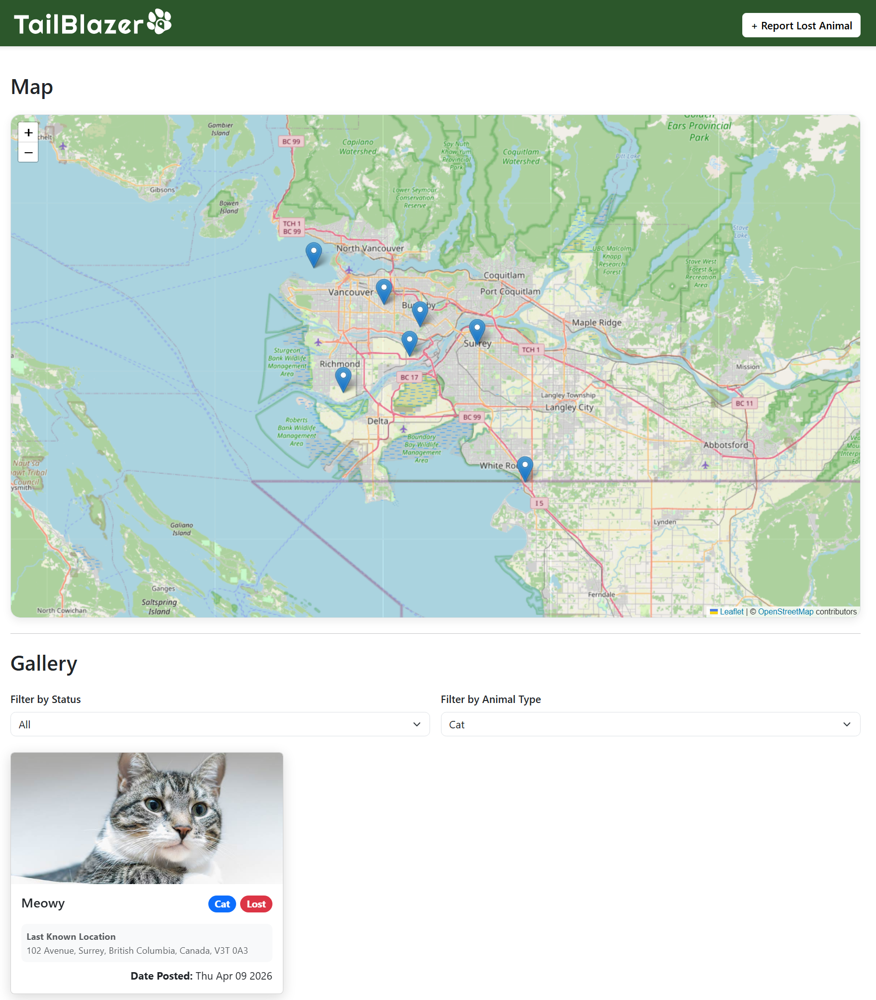

# TailBlazer — Lost Animal Reporting System

*Solo course project for CMPT 272 (Spring 2026), Simon Fraser University.*



TailBlazer is a lost animal reporting website built with React, CSS, and React Bootstrap. Users can
submit lost animal reports and view animals using an interactive map or gallery. The map is rendered
using Leaflet with markers showing lost animals.

## How It Works

Users submit animal reports using a form. Form validation is applied to all fields except pictures
and descriptions. Users can upload an image; the ImgBB API hosts it and returns a URL that is used
to display the image after submission. A Leaflet map lets the user select the last known location,
and the coordinates are reverse-geocoded using the Nominatim API so a readable address is displayed
back.

The JSONBin API is used to host all submitted reports. On the home page, the Leaflet map is
populated with markers for lost animals. Clicking a marker shows a popup with some details and a
"view more" button that opens a details modal. The gallery is an optional view for the map, and
clicking a card opens the same details modal. The details modal shows the animal's picture (a
placeholder image is used when no image was uploaded), its details, and a Leaflet map with a marker
for the last known location. A button for marking the animal as "found" prompts the user to enter
the password they provided when creating the report, to prove ownership.

## Features

- Interactive map using Leaflet
    - Clickable markers open detailed popups with report information
- Create reports
    - Upload an animal image with live preview
    - Select the last seen location directly on the map
    - Reverse geocoding using Nominatim to display a readable address
    - Form validation
- Report browsing and filtering
    - Filter reports by status
    - Filter reports by animal type
    - Responsive card-based gallery view
- Details modal
    - Image, key details, and contact information
    - Embedded map showing the last known location
    - Password-protected "Mark as found" functionality
- Image hosting and data persistence
    - Images uploaded via ImgBB
    - Report data stored using JSONBin
    - Async/await used for all API interactions
- UI built with React Bootstrap and CSS
- Custom logo

## Tech Stack

React, TypeScript, Vite, React Bootstrap, CSS, Leaflet (react-leaflet), JSONBin, ImgBB, Nominatim

## Running Locally

1. Clone the repository and install dependencies:
   ```
   npm install
   ```
2. Create a free account on [ImgBB](https://imgbb.com/) and generate an API key.
3. Create a free account on [JSONBin.io](https://jsonbin.io), generate an API key, and create a new
   bin containing a blank reports object:
   ```json
   {
       "reports": []
   }
   ```
4. Copy `.env_example` to a new file named `.env` (do not put real keys in `.env_example`; `.env` is
   git-ignored) and fill in your values:
   ```
   VITE_JSONBIN_BIN_ID=your JSONBin bin ID
   VITE_JSONBIN_API_KEY=your JSONBin API key
   VITE_IMGBB_API_KEY=your ImgBB API key
   ```
5. Start the dev server:
   ```
   npm run dev
   ```

And let's find those animals!

## Known Limitations

- Passwords for the "Mark as found" feature are stored as plain text and are not hashed.
- There is no backend. The JSONBin and ImgBB keys are bundled into the client-side build, so anyone
  using a deployed copy of the site could read them. A production version would need a backend to
  keep keys private, hash passwords, and control who can read contact information. If you deploy
  this publicly, use restricted keys.

## Citations

Code snippets and references:

- React: https://react.dev/
- React Bootstrap: https://react-bootstrap.github.io/docs/
- Leaflet:
    - https://react-leaflet.js.org/docs/
    - https://leafletjs.com/reference-2.0.0.html
- Regex Generator: https://regex-generator.olafneumann.org
- Class demos:
    - https://www.youtube.com/playlist?list=PLg7lel5LdVjzKYyjdlLqoqomDCwP3pmWU
    - https://github.com/bobbychansfu/cmpt272_code

APIs:

- JSONBin: https://jsonbin.io
- ImgBB: https://imgbb.com/
- Nominatim: https://nominatim.org/

README editor:

- https://readme.so/editor